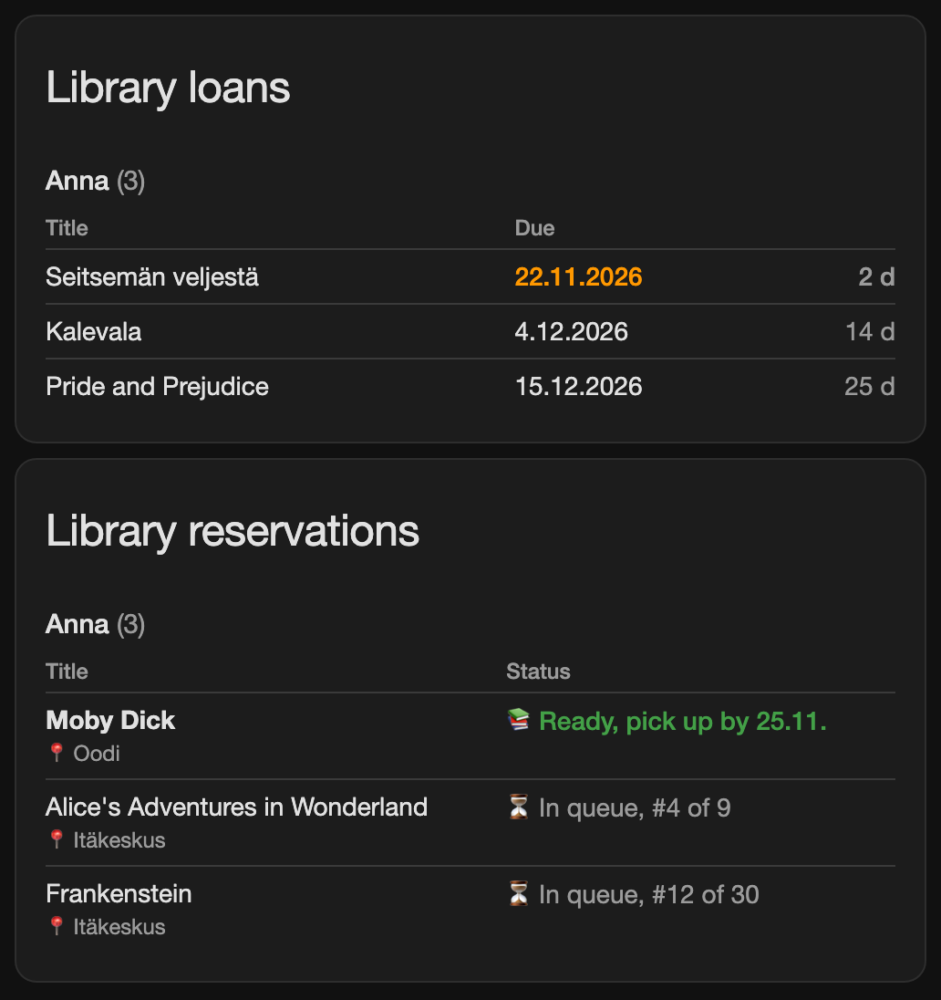

# Helmet library loans for Home Assistant

> [!WARNING]
> **Unofficial and not supported by Helmet. Use at your own risk.**
>
> This integration is not affiliated with or endorsed by the Helmet libraries or the
> National Library of Finland. The [helmet.finna.fi terms of use](https://helmet.finna.fi/Content/terms)
> prohibit automated use of features that require signing in, and this integration
> signs in automatically. Helmet has no official API for personal loan data. Permission
> and an official API are being requested from Helmet. Until they are granted, Helmet may
> block access or your library card, and the integration may stop working at any time.

Shows your [Helmet](https://helmet.finna.fi/) library loans with due dates, and
reservations that are ready for pickup, as Home Assistant sensors. Add it once per
library card, so a whole family can be followed on one dashboard.



## How it works

Every 6 hours the integration signs in to helmet.finna.fi with the card number and PIN,
reads the "Checked out items" and "Holds" pages, and signs out. Helmet has no public
API for personal loan data, so a redesign of those pages can break the lists. The
counts come from a separate site endpoint and usually keep working; Home Assistant
logs a warning when the counts and the lists disagree.

The card number and PIN are stored only in your Home Assistant configuration and are
sent only to helmet.finna.fi.

## Install

### HACS (custom repository)

1. HACS → ⋮ → Custom repositories → add `https://github.com/Crare/ha-helmet`,
   type **Integration**.
2. Search for **Helmet library loans** in HACS and download it.
3. Restart Home Assistant.

### Manual

Copy `custom_components/helmet` into your Home Assistant `config/custom_components/`
folder (so you have `config/custom_components/helmet/manifest.json`) and restart.

## Setup

Settings → Devices & services → Add integration → **Helmet library loans**. Enter a
name (for example the person's first name), the library card number and PIN.
Repeat for each library card.

If a PIN changes, Home Assistant asks for the new one under Settings → Repairs.

## Sensors (per card)

Entity IDs follow the name you gave, e.g. `sensor.anna_loans`.

| Sensor | State | Attributes |
| --- | --- | --- |
| Loans | number of loans | `loans`: list of `title`, `due_date`, soonest first |
| Next due date | earliest due date | |
| Overdue | number of overdue loans | |
| Reservations | number of reservations | `holds`: list of `title`, `ready`, `pickup_by`, `queue_position`, `queue_length`, `pickup_location`, ready ones first |
| Ready for pickup | reservations waiting at the library | `holds`: list of `title`, `pickup_by`; `waiting`: reservations still in the queue |
| Next pickup deadline | earliest last pickup day | |

## Dashboard cards

The integration includes two ready-made cards:

- **Helmet loans** (`custom:helmet-loans-card`): every library card's loans with due
  date and days left (orange within 3 days, red when overdue).
- **Helmet reservations** (`custom:helmet-reservations-card`): every library card's
  reservations; ready ones first with the last pickup day, waiting ones with
  their queue position; each with its pickup library.

They find all Helmet library cards by themselves, use each card's name as the
heading, and show Finnish or English text depending on your Home Assistant language.

### Adding the cards to a dashboard

1. Install the integration and add at least one library card (see [Install](#install)
   and [Setup](#setup)).
2. Restart Home Assistant once after installing or updating. The cards are loaded at
   startup, so they are not available before the restart.
3. Open the dashboard and select ✏️ **Edit dashboard** (top right).
4. Select **Add card**, type **Helmet** in the search box, and pick **Helmet loans**
   or **Helmet reservations**.
5. Select **Save**. Repeat for the other card.

The only option is `title`. To change it, open the card's code editor
(**Show code editor**):

```yaml
type: custom:helmet-loans-card
title: Kirjaston lainat
```

**If the cards are not in the list:** check that Home Assistant has been restarted
since the update and that HACS shows the latest version, then reload the page. On the
phone app, clear its cache under Settings → Companion app → Debugging → Reset
frontend cache.

**If a card says no library cards were found:** the integration has no library card
added yet, or it could not update. Check Settings → Devices & services → Helmet
library loans.

## Making your own cards

Every library card gets the sensors listed under [Sensors](#sensors-per-card). Their
names follow the name you gave the library card, e.g. `sensor.anna_loans`. To see
the exact entity IDs, open Developer tools → **States** and search for `helmet` or
the name. The lists (titles, due dates, reservations) are in the sensors'
attributes, which templates can read.

Try templates in Developer tools → **Template** before putting them on a card.

### A single value as a tile

The simplest card shows one sensor. Edit dashboard → Add card → **Tile** and pick,
for example, `sensor.anna_next_due_date` or `sensor.anna_ready_for_pickup`. Or in
the code editor:

```yaml
type: tile
entity: sensor.anna_next_due_date
name: Anna's next due date
```

### A notice only when something is ready for pickup

A conditional card that stays hidden until a reservation is waiting at the library:

```yaml
type: conditional
conditions:
  - condition: numeric_state
    entity: sensor.anna_ready_for_pickup
    above: 0
card:
  type: markdown
  content: |-
    📚 **Anna has {{ states('sensor.anna_ready_for_pickup') }} reservation(s) ready for pickup:**
    
    - {{ h.title }} (by {{ strptime(h.pickup_by, '%Y-%m-%d').strftime('%-d.%-m.') }})
    
```

### Your own list with a Markdown card

A Markdown card can list anything from the attributes. This one shows every loan,
from all library cards, that is due within a week:

```yaml
type: markdown
title: Due this week
content: |-
  
  
  
  {%- set days = (strptime(l.due_date, '%Y-%m-%d').date() - now().date()).days -%}
  
  
  
  
  
  
  - {{ title }}: {{ 'overdue' if days < 0 else 'today' if days == 0 else 'in ' ~ days ~ ' d' }}
  
  Nothing due this week 🎉
  
```

Useful pieces for your own templates:

| Template | Gives |
| --- | --- |
| `integration_entities('helmet')` | all Helmet sensors |
| `state_attr('sensor.anna_loans', 'loans')` | list of loans: `title`, `due_date` (`YYYY-MM-DD`) |
| `state_attr('sensor.anna_reservations', 'holds')` | list of reservations: `title`, `ready`, `pickup_by`, `queue_position`, `queue_length`, `pickup_location` |
| `states('sensor.anna_overdue')` | number of overdue loans |
| `strptime(x, '%Y-%m-%d')` | turns a date attribute into a date you can compare or format |

More Markdown versions of the cards, which also work without the integration's
card file, are in [`dashboard/`](dashboard).

## Notification when a reservation is ready

Replace the entity and the notify action with your own:

```yaml
alias: Helmet reservation ready for pickup
triggers:
  - trigger: state
    entity_id: sensor.anna_ready_for_pickup
conditions:
  - condition: template
    value_template: "{{ trigger.to_state.state | int(0) > trigger.from_state.state | int(0) }}"
actions:
  - action: notify.mobile_app_your_phone
    data:
      message: "A Helmet reservation is ready for pickup for Anna."
```

## Reporting a problem

To check a card outside Home Assistant, run the check script on your own computer.
It asks for the card number and PIN without showing them and prints only whether
the login worked and how many items it read, which is safe to share:

```bash
python3 -m venv .venv
.venv/bin/pip install aiohttp beautifulsoup4
.venv/bin/python scripts/check_login.py
```

If the lists are empty or wrong, open an issue with that output or the warning from
the Home Assistant log. **Never post your card number, PIN or saved pages that contain your
name or loans.**

## Development

```bash
python -m pip install beautifulsoup4 pytest
python -m pytest tests
```

## Icon

The integration's icon (`custom_components/helmet/brand/`, source in
[`docs/icon.svg`](docs/icon.svg)) is an original drawing of a house roofline over an
open book. It does not use the Helmet or Home Assistant logos. Home Assistant 2026.x
shows it from the integration's own `brand` folder.

## License

MIT. See [LICENSE](LICENSE).
